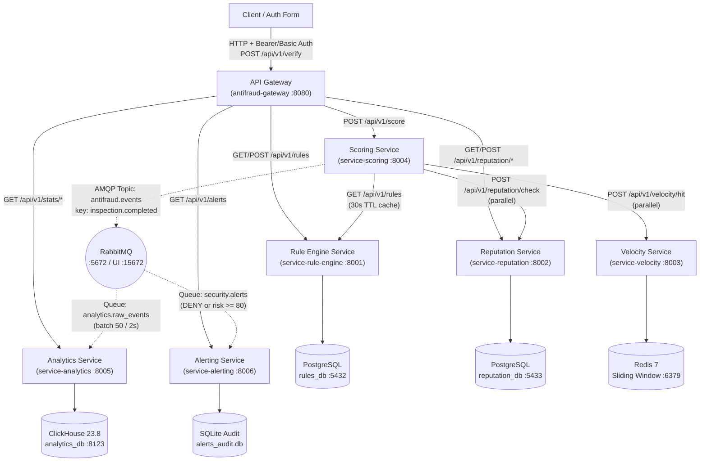

# Demo A2P Anti-Fraud System (`Demo-a2p-antifraud-sys`)

A distributed microservice platform for preventive A2P SMS authentication traffic inspection, engineered to detect and mitigate **SMS Pumping / Artificial Inflation of Traffic (AIT)** and **Denial of Wallet** attacks in real time.

Full architecture specification: [`system_architecture_specification.md`](./system_architecture_specification.md).

---

## Architecture Diagram



---

## Services & Technology Stack

| Component | Container | Port | Persistence / Broker | Responsibility |
| :--- | :--- | :---: | :--- | :--- |
| **API Gateway** | `antifraud-gateway` | `8080` | Stateless (`httpx`) | Single ingress, Bearer/X-API-Key/Basic auth, UUID4 `X-Request-ID` injection, reverse proxy |
| **Rule Engine Service** | `service-rule-engine` | `8001` | PostgreSQL `rules_db` (`5432`) | Fraud heuristics, thresholds, weights, startup seed rules |
| **Reputation Service** | `service-reputation` | `8002` | PostgreSQL `reputation_db` (`5433`) | Indexed blacklist lookup (`IP`, `PHONE`, `MCC_MNC`), pre-seeded mock bad actors |
| **Velocity Service** | `service-velocity` | `8003` | Redis 7 (`6379`) | Atomic Redis Sorted Set sliding window (60s IP, 300s phone) with fail-open fallback |
| **Scoring Service** | `service-scoring` | `8004` | RabbitMQ publisher (`5672`) | Parallel orchestration, dynamic Risk Score (`0.0–100.0`, `>= 60.0` = `DENY`), event publish |
| **Analytics Service** | `service-analytics` | `8005` | ClickHouse `analytics_db` (`8123`) | RabbitMQ batch consumer (50 events / 2s flush), MergeTree OLAP storage, 1h stats API |
| **Alerting Service** | `service-alerting` | `8006` | SQLite Audit (`/data/alerts_audit.db`) | RabbitMQ consumer, CEF (`CEF:0`) alerts on `DENY` / `risk_score >= 80`, audit API |

### Key Architectural Choices
- **Database-per-Service:** Strict persistence isolation (`rules_db`, `reputation_db`, Redis, ClickHouse, SQLite) with zero shared databases.
- **Synchronous vs. Asynchronous Split:** Low-latency verification (`Gateway -> Scoring -> Rule Engine / Reputation / Velocity`) runs concurrently over pooled keep-alive `httpx` connections; analytics ingestion and CEF security alerting run asynchronously via RabbitMQ topic exchange `antifraud.events` (`inspection.completed`).
- **Observability & Error Handling:** Single-line structured JSON logs (`timestamp`, `service`, `level`, `request_id`, `message`), propagated `X-Request-ID`, standardized `ErrorEnvelope` responses without raw stack traces, and `/health` + `/ready` probes on every container.

---

## Endpoint Catalog

### External API Gateway (`http://localhost:8080`)

All `/api/v1/*` routes require authentication via one of:
- `Authorization: Bearer antifraud-demo-key`
- `X-API-Key: antifraud-demo-key`
- `Authorization: Basic <base64(antifraud:antifraud-secret)>`

| Method | Path | Downstream Target | Description |
| :--- | :--- | :--- | :--- |
| `POST` | `/api/v1/verify` | `service-scoring:8004/api/v1/score` | Inspect SMS auth request (`SMSCheckRequest` -> `InspectionResult`) |
| `GET` | `/api/v1/rules` | `service-rule-engine:8001/api/v1/rules` | List active fraud scoring rules |
| `POST` | `/api/v1/rules` | `service-rule-engine:8001/api/v1/rules` | Create a new scoring rule |
| `POST` | `/api/v1/reputation/check` | `service-reputation:8002/api/v1/reputation/check` | Check entities against blacklist |
| `POST` | `/api/v1/reputation/blacklist` | `service-reputation:8002/api/v1/reputation/blacklist` | Add `IP` / `PHONE` / `MCC_MNC` to blacklist |
| `GET` | `/api/v1/reputation/blacklist` | `service-reputation:8002/api/v1/reputation/blacklist` | List blacklisted entities |
| `GET` | `/api/v1/analytics/stats/summary` | `service-analytics:8005/api/v1/stats/summary` | Last-hour aggregate traffic statistics |
| `GET` | `/api/v1/alerts` | `service-alerting:8006/api/v1/alerts` | Retrieve last 50 CEF security alerts (supports `?severity=HIGH\|CRITICAL`) |
| `GET` | `/health` | Gateway (public) | Liveness probe |
| `GET` | `/ready` | Gateway (public) | Readiness probe checking downstream `/health` endpoints |

### Direct Microservice Swagger Docs & Admin UIs
- **API Gateway Swagger:** `http://localhost:8080/docs`
- **Rule Engine Swagger:** `http://localhost:8001/docs`
- **Reputation Swagger:** `http://localhost:8002/docs`
- **Velocity Swagger:** `http://localhost:8003/docs`
- **Scoring Swagger:** `http://localhost:8004/docs`
- **Analytics Swagger:** `http://localhost:8005/docs`
- **Alerting Swagger:** `http://localhost:8006/docs`
- **RabbitMQ Management UI:** `http://localhost:15672` (`guest` / `guest`)

---

## Setup & Quick Start

### 1. Prepare Environment
```bash
cp .env.example .env
```

### 2. Start the Entire Platform (12 Containers)
```bash
docker compose up -d --build
docker compose ps
```
All services use strict `depends_on` healthcheck chains (`service_healthy`), ensuring databases and RabbitMQ come online before domain services, scoring, consumers, and the API Gateway.

### 3. Verify End-to-End Flow

**PowerShell (Windows):**
```powershell
$headers = @{ Authorization = "Bearer antifraud-demo-key" }

# 1. Inspect a clean SMS request (expected: ALLOW, risk_score: 0.0)
$clean = @{
  client_ip = "203.0.113.10"
  phone_number = "+14155552671"
  mcc_mnc = "310260"
  message_length = 24
} | ConvertTo-Json
Invoke-RestMethod -Method Post -Uri http://localhost:8080/api/v1/verify -Headers $headers -ContentType "application/json" -Body $clean

# 2. Inspect a pre-seeded bad actor (IP 198.51.100.24 / Gabon 62801 -> expected: DENY, risk_score: 100.0)
$fraud = @{
  client_ip = "198.51.100.24"
  phone_number = "+24101234567"
  mcc_mnc = "62801"
  message_length = 24
} | ConvertTo-Json
Invoke-RestMethod -Method Post -Uri http://localhost:8080/api/v1/verify -Headers $headers -ContentType "application/json" -Body $fraud

# 3. Inspect generated CEF security alerts and 1h ClickHouse analytics
Invoke-RestMethod -Uri http://localhost:8080/api/v1/alerts -Headers $headers
Invoke-RestMethod -Uri http://localhost:8080/api/v1/analytics/stats/summary -Headers $headers
```

**curl (Linux / macOS / Git Bash):**
```bash
curl -X POST http://localhost:8080/api/v1/verify \
  -H "Authorization: Bearer antifraud-demo-key" \
  -H "Content-Type: application/json" \
  -d '{"client_ip":"198.51.100.24","phone_number":"+24101234567","mcc_mnc":"62801","message_length":24}'
```

### 4. Stop Containers
```bash
docker compose down        # keep persistent volumes
docker compose down -v     # reset all databases and volumes
```

---

## Automated Testing

Install dependencies and run all unit, service, and end-to-end integration tests:

```bash
pip install \
  -r gateway/requirements.txt \
  -r services/rule-engine/requirements.txt \
  -r services/reputation/requirements.txt \
  -r services/velocity/requirements.txt \
  -r services/scoring/requirements.txt \
  -r services/analytics/requirements.txt \
  -r services/alerting/requirements.txt

python -m pytest -v
```

Validate Docker Compose topology:
```bash
docker compose config -q
```

---

## Repository Layout

```text
.
├── .github/workflows/ci.yml        # Automated Compose validation & pytest CI
├── gateway/                        # FastAPI API Gateway (Port 8080)
├── services/
│   ├── rule-engine/                # Microservice 1: Rule Engine (Port 8001, Postgres rules_db)
│   ├── reputation/                 # Microservice 2: Reputation (Port 8002, Postgres reputation_db)
│   ├── velocity/                   # Microservice 3: Velocity (Port 8003, Redis)
│   ├── scoring/                    # Microservice 4: Scoring Engine (Port 8004, httpx + RabbitMQ)
│   ├── analytics/                  # Microservice 5: Analytics Ingest (Port 8005, RabbitMQ + ClickHouse)
│   └── alerting/                   # Microservice 6: Alerting & CEF Audit (Port 8006, RabbitMQ + SQLite)
├── shared/                         # Shared Pydantic DTOs & structured JSON logger
├── infrastructure/                 # Initial SQL DDL & seed scripts (Postgres & ClickHouse)
├── tests/
│   ├── unit/                       # Scoring calculation unit tests
│   └── integration/                # Full Gateway -> 6-service E2E integration tests
├── docker-compose.yml              # Unified 12-container topology with healthcheck depends_on
├── Makefile                        # Dev/test automation targets
└── system_architecture_specification.md
```
