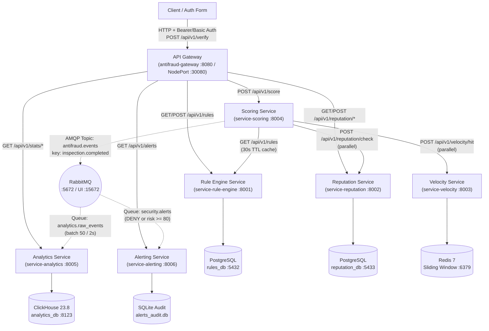

# Demo A2P Anti-Fraud System (`Demo-a2p-antifraud-sys`)

[](https://github.com/obrazovan/Demo-a2p-antifraud-sys/actions/workflows/ci-cd.yml)

## 1. Описание проекта

**Demo A2P Anti-Fraud System** — распределённая микросервисная платформа превентивной инспекции A2P SMS-трафика аутентификации, разработанная для обнаружения и блокировки атак **SMS Pumping / Artificial Inflation of Traffic (AIT)** и **Denial of Wallet** в реальном времени.

Репозиторий объединяет:
- **Лабораторную работу №2 (Микросервисная архитектура):** API Gateway + 6 независимых backend-микросервисов с паттерном *Database-per-Service*, синхронным (`REST/httpx`) и асинхронным (`RabbitMQ/aio_pika`) взаимодействием.
- **Лабораторную работу №3 (Docker и Kubernetes):** оптимизированные multi-stage `Dockerfile` (non-root `appuser`, `.dockerignore`), оркестрация `docker-compose.yml` и полный комплект манифестов Kubernetes в [`k8s/`](./k8s/README.md) (`Namespace`, `ConfigMap`, `Secret`, `PersistentVolumeClaim`, `Deployment`, `Service`, Kustomize).
- **Production CI/CD Pipeline (GitHub Actions):** полный 5-этапный конвейер [`.github/workflows/ci-cd.yml`](./.github/workflows/ci-cd.yml) — статический анализ (Ruff + проверки Dockerfiles), 66 автотестов (Unit, Integration, K8s), строгая валидация манифестов (`kubeconform`), матричная сборка и Trivy-сканирование всех 7 образов с публикацией в GHCR, а также Continuous Deployment в Kubernetes.

Полная архитектурная спецификация: [`system_architecture_specification.md`](./system_architecture_specification.md).  
Документация по развёртыванию в Kubernetes: [`k8s/README.md`](./k8s/README.md).

---

## 2. Архитектура



---

## 3. Используемые технологии

| Компонент | Контейнер / K8s Service | Порт | Стек и Хранилище | Назначение |
| :--- | :--- | :---: | :--- | :--- |
| **API Gateway** | `antifraud-gateway` | `8080` (`30080`) | FastAPI, `httpx` | Единая точка входа, Bearer/X-API-Key/Basic Auth, генерация `X-Request-ID` |
| **Rule Engine** | `service-rule-engine` | `8001` | FastAPI, SQLAlchemy 2.0, `asyncpg`, PostgreSQL `rules_db` | Управление правилами, порогами и весами риска |
| **Reputation** | `service-reputation` | `8002` | FastAPI, SQLAlchemy 2.0, `asyncpg`, PostgreSQL `reputation_db` | Чёрные списки `IP`, `PHONE`, `MCC_MNC` |
| **Velocity** | `service-velocity` | `8003` | FastAPI, `redis.asyncio`, Redis 7 (`ZSET`) | Скользящие окна частоты (60 с IP, 300 с телефон) с fail-open fallback |
| **Scoring** | `service-scoring` | `8004` | FastAPI, `httpx`, `aio_pika` | Параллельный опрос, расчёт Risk Score (`>= 60` = `DENY`), публикация в RabbitMQ |
| **Analytics** | `service-analytics` | `8005` | FastAPI, `aio_pika`, `clickhouse-connect`, ClickHouse 23.8 | Пакетная запись (50 шт / 2 с) в `MergeTree` и аналитика за 1 час |
| **Alerting** | `service-alerting` | `8006` | FastAPI, `aio_pika`, `aiosqlite`, SQLite | Генерация CEF (`CEF:0`) алертов при `DENY` / `risk >= 80`, журнал аудита |

---

## 4. Установка

```bash
git clone https://github.com/obrazovan/Demo-a2p-antifraud-sys.git
cd Demo-a2p-antifraud-sys
cp .env.example .env
```

---

## 5. Запуск

### Вариант A: Запуск в Docker Compose (Лабораторная №2)
```bash
docker compose up -d --build
docker compose ps
```

### Вариант B: Запуск в Kubernetes / Minikube (Лабораторная №3)
```bash
# 1. Собрать локальные образы
docker compose build

# 2. (Опционально для Minikube) загрузить образы в кластер
# minikube image load lab2-antifraud-gateway:latest lab2-service-rule-engine:latest lab2-service-reputation:latest lab2-service-velocity:latest lab2-service-scoring:latest lab2-service-analytics:latest lab2-service-alerting:latest

# 3. Развернуть все 34 ресурса в namespace `antifraud`
kubectl apply -k k8s/
kubectl get pods,svc,deployments,pvc -n antifraud
```

---

## 6. Configuration

- В каждом сервисе конфигурация управляется через `pydantic-settings` (`src/config.py`).
- Для Docker Compose используется `.env` (шаблон — [`.env.example`](./.env.example)).
- Для Kubernetes несекретные параметры вынесены в [`k8s/configmaps/app-configmap.yaml`](./k8s/configmaps/app-configmap.yaml) и [`k8s/configmaps/db-init-configmap.yaml`](./k8s/configmaps/db-init-configmap.yaml), а пароли и API-ключи — в [`k8s/secrets/app-secret.yaml`](./k8s/secrets/app-secret.yaml) (шаблон — [`k8s/secrets/app-secret.example.yaml`](./k8s/secrets/app-secret.example.yaml)).

---

## 7. API

Все маршруты `/api/v1/*` на API Gateway (`:8080` в Compose / `:30080` в K8s NodePort) защищены заголовком `Authorization: Bearer antifraud-demo-key`, `X-API-Key: antifraud-demo-key` или `Basic Auth` (`antifraud:antifraud-secret`):

| Метод | Endpoint | Назначение |
| :--- | :--- | :--- |
| `POST` | `/api/v1/verify` | Проверка SMS-запроса (`SMSCheckRequest` → `InspectionResult`) |
| `GET` | `/api/v1/rules` | Получение списка активных правил скоринга |
| `POST` | `/api/v1/rules` | Создание нового правила скоринга |
| `POST` | `/api/v1/reputation/check` | Проверка `ip`, `phone`, `mcc_mnc` по чёрному списку |
| `POST` | `/api/v1/reputation/blacklist` | Добавление сущности в чёрный список |
| `GET` | `/api/v1/reputation/blacklist` | Список заблокированных сущностей |
| `GET` | `/api/v1/analytics/stats/summary` | Сводная статистика за последний час из ClickHouse |
| `GET` | `/api/v1/alerts` | Последние 50 CEF-алертов безопасности (`?severity=HIGH\|CRITICAL`) |
| `GET` | `/health` / `/ready` | Пробы жизнеспособности и готовности (на всех 7 сервисах) |

---

## 8. Примеры использования

```powershell
$headers = @{ Authorization = "Bearer antifraud-demo-key" }

# 1. Чистый SMS-запрос (ALLOW, risk_score: 0.0)
$clean = @{ client_ip="203.0.113.10"; phone_number="+14155552671"; mcc_mnc="310260"; message_length=24 } | ConvertTo-Json
Invoke-RestMethod -Method Post -Uri http://localhost:8080/api/v1/verify -Headers $headers -ContentType "application/json" -Body $clean

# 2. Мошеннический SMS-запрос (DENY, risk_score: 100.0)
$fraud = @{ client_ip="198.51.100.24"; phone_number="+24101234567"; mcc_mnc="62801"; message_length=24 } | ConvertTo-Json
Invoke-RestMethod -Method Post -Uri http://localhost:8080/api/v1/verify -Headers $headers -ContentType "application/json" -Body $fraud

# 3. Просмотр CEF-алертов и статистики ClickHouse
Invoke-RestMethod -Uri http://localhost:8080/api/v1/alerts -Headers $headers
Invoke-RestMethod -Uri http://localhost:8080/api/v1/analytics/stats/summary -Headers $headers
```

Масштабирование и самовосстановление в Kubernetes:
```bash
kubectl scale deployment service-scoring -n antifraud --replicas=3
kubectl delete pod -n antifraud -l app=service-scoring
kubectl get pods -n antifraud -w
```

---

## 9. Тестирование

Полный набор из **63 автоматических тестов** (unit-тесты скоринга, сервисные тесты всех 6 микросервисов, валидация всех Dockerfile и Kubernetes-манифестов, сквозные E2E-тесты через Gateway):

```bash
pip install pyyaml \
  -r gateway/requirements.txt \
  -r services/rule-engine/requirements.txt \
  -r services/reputation/requirements.txt \
  -r services/velocity/requirements.txt \
  -r services/scoring/requirements.txt \
  -r services/analytics/requirements.txt \
  -r services/alerting/requirements.txt

python -m pytest -v
docker compose config -q
kubectl kustomize k8s/ > /dev/null
```

---

## 10. Результаты экспериментов

1. **Задержка горячего пути (Scoring Latency):** при холодном кэше правил первый запрос выполняется за `~30.6 мс`, все последующие запросы при прогретом 30-секундном TTL-кэше и параллельном `asyncio.gather` выполняются за **`~9.5 мс`** (целевой SLA $\le 15$ мс).
2. **Пакетная вставка в ClickHouse:** буферизация по `50` событий или `2.0` с снижает число HTTP-вставок в `MergeTree` до 50 раз при пиковой нагрузке без потери данных благодаря ручному `ack()` после `insert_batch`.
3. **Оптимизация контейнеров и K8s:** multi-stage сборка (`python:3.11-slim`) + `.dockerignore` уменьшают размер образов в ~4 раза; в Kubernetes `Deployment` с `replicas: 2–3` и `readinessProbe` (`/ready`) обеспечивает безотказное масштабирование и автоматическое пересоздание удалённых Pod'ов за `< 1 с`.

---

## 11. Выводы

Разработана и протестирована полноценная микросервисная антифрод-платформа из 6 бизнес-сервисов и API Gateway с полной изоляцией баз данных (PostgreSQL ×2, Redis, ClickHouse, SQLite), гибридным синхронно-асинхронным взаимодействием (REST + RabbitMQ) и промышленной контейнеризацией для Docker Compose и Kubernetes.
