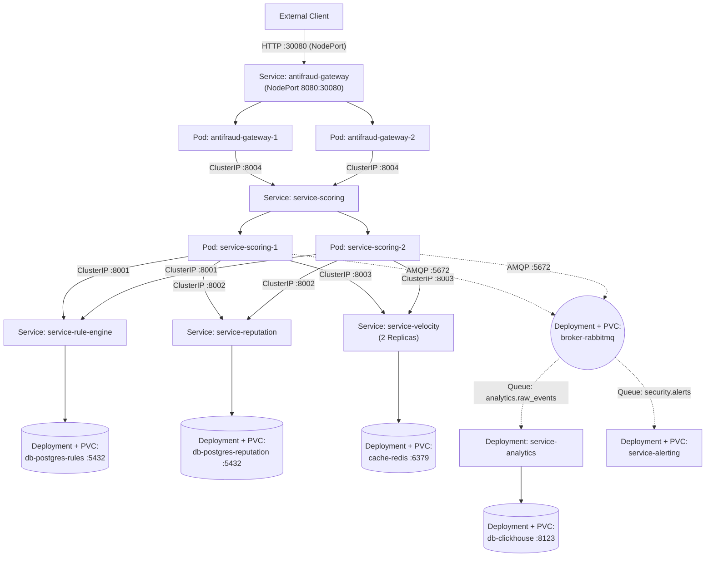

# Лабораторная работа №3. Контейнеризация Docker и Оркестрация Kubernetes (`k8s/`)

## 1. Описание проекта

В рамках Лабораторной работы №3 распределённая микросервисная антифрод-платформа **A2P Anti-Fraud System** (из Лабораторной работы №2) полностью оптимизирована для контейнеризации в **Docker** и развёртывания в кластере **Kubernetes** (Docker Desktop Kubernetes / Minikube).

Система состоит из **12 компонентов** в выделенном пространстве имён `antifraud`:
- **API Gateway** (`antifraud-gateway`, `replicas: 2`, `NodePort: 30080`)
- **6 бизнес-микросервисов:** `service-rule-engine`, `service-reputation`, `service-velocity` (`replicas: 2`), `service-scoring` (`replicas: 2`), `service-analytics`, `service-alerting` (`replicas: 1` + PVC)
- **5 инфраструктурных узлов с постоянными томами (`PersistentVolumeClaim`):** `db-postgres-rules`, `db-postgres-reputation`, `cache-redis`, `broker-rabbitmq`, `db-clickhouse`.

---

## 2. Архитектура в Kubernetes



### Структура манифестов `k8s/`

```text
k8s/
├── README.md
├── kustomization.yaml              # Единая точка сборки (kubectl apply -k k8s/)
├── namespace.yaml                  # Namespace: antifraud
├── configmaps/
│   ├── app-configmap.yaml          # Несекретные URL сервисов (ClusterIP DNS), пороги, лимиты
│   └── db-init-configmap.yaml      # SQL-скрипты инициализации БД
├── secrets/
│   ├── app-secret.example.yaml     # Безопасный шаблон Secret без открытых паролей
│   └── app-secret.yaml             # Kubernetes Secret (base64) для локального кластера
├── infrastructure/                 # PVC + Deployment + ClusterIP Service для БД и брокера
│   ├── postgres-rules.yaml
│   ├── postgres-reputation.yaml
│   ├── redis.yaml
│   ├── rabbitmq.yaml
│   └── clickhouse.yaml
├── deployments/                    # Deployments для 6 бизнес-сервисов и Gateway
│   ├── rule-engine-deployment.yaml
│   ├── reputation-deployment.yaml
│   ├── velocity-deployment.yaml
│   ├── scoring-deployment.yaml
│   ├── analytics-deployment.yaml
│   ├── alerting-deployment.yaml
│   └── gateway-deployment.yaml
└── services/                       # Kubernetes Services (ClusterIP + NodePort для Gateway)
    ├── rule-engine-service.yaml
    ├── reputation-service.yaml
    ├── velocity-service.yaml
    ├── scoring-service.yaml
    ├── analytics-service.yaml
    ├── alerting-service.yaml
    └── gateway-service.yaml
```

---

## 3. Используемые технологии

- **Docker (Multi-Stage Builds):** базовый образ `python:3.11-slim`, сборка виртуального окружения `/opt/venv` в стадии `builder`, копирование в минимальный `runner`-образ, запуск от непривилегированного пользователя `appuser` (`UID 1001`), `.dockerignore` во всех сервисах.
- **Docker Compose:** локальная оркестрация 12 контейнеров с `depends_on: condition: service_healthy`.
- **Kubernetes & Kustomize:** `Namespace`, `Deployment`, `Service` (`ClusterIP` и `NodePort`), `ConfigMap`, `Secret`, `PersistentVolumeClaim`, `livenessProbe` (`/health`), `readinessProbe` (`/ready`), `resources.requests` и `resources.limits`, `securityContext` (`runAsNonRoot: true`).

---

## 4. Установка и подготовка образов

1. Убедитесь, что запущен **Docker Desktop** с включённым **Kubernetes** (*Settings → Kubernetes → Enable Kubernetes*) или **Minikube** (`minikube start`).
2. Соберите локальные Docker-образы всех микросервисов из корня репозитория:
   ```bash
   docker compose build
   ```
   *(Если используется Minikube, загрузите собранные образы в узел кластера:)*
   ```bash
   minikube image load lab2-antifraud-gateway:latest lab2-service-rule-engine:latest lab2-service-reputation:latest lab2-service-velocity:latest lab2-service-scoring:latest lab2-service-analytics:latest lab2-service-alerting:latest
   ```

---

## 5. Запуск в Kubernetes

Примените все 34 ресурса кластера одной командой через Kustomize:

```bash
kubectl apply -k k8s/
```

Проверьте состояние ресурсов:

```bash
kubectl get namespaces
kubectl get pods -n antifraud
kubectl get deployments -n antifraud
kubectl get services -n antifraud
kubectl get pvc -n antifraud
```

---

## 6. Configuration (ConfigMap и Secret)

- **`ConfigMap` (`antifraud-config`):** содержит адреса межсервисного взаимодействия по внутреннему DNS Kubernetes (`http://service-scoring:8004`, `http://service-rule-engine:8001`, `redis://cache-redis:6379/0` и т.д. — без использования `localhost`), пороги риска (`DENY_THRESHOLD=60.0`, `CRITICAL_RISK_THRESHOLD=80.0`) и параметры батчинга (`BATCH_SIZE=50`, `FLUSH_INTERVAL_SECONDS=2.0`).
- **`ConfigMap` (`antifraud-db-init`):** монтирует SQL-скрипты начальной инициализации таблиц и стартовых правил в контейнеры PostgreSQL и ClickHouse.
- **`Secret` (`antifraud-secrets`):** хранит пароли БД, строку подключения к RabbitMQ и API-ключи шлюза в base64-кодированном виде (`k8s/secrets/app-secret.yaml`, шаблон — в `k8s/secrets/app-secret.example.yaml`).

---

## 7. API и доступ к кластеру

Внешний трафик поступает на сервис `antifraud-gateway` типа `NodePort` (порт `8080`, внешний `nodePort: 30080`):
- В **Docker Desktop Kubernetes**: `http://localhost:30080`
- Либо через проброс порта в любом кластере:
  ```bash
  kubectl port-forward svc/antifraud-gateway -n antifraud 8080:8080
  ```

---

## 8. Примеры использования и сценарии демонстрации на защите

### 8.1. Реальные запросы к API в Kubernetes
```powershell
$headers = @{ Authorization = "Bearer antifraud-demo-key" }

# Чистый запрос -> ALLOW (0.0)
$clean = @{ client_ip="203.0.113.10"; phone_number="+14155552671"; mcc_mnc="310260"; message_length=24 } | ConvertTo-Json
Invoke-RestMethod -Method Post -Uri http://localhost:30080/api/v1/verify -Headers $headers -ContentType "application/json" -Body $clean

# Мошеннический запрос -> DENY (100.0)
$fraud = @{ client_ip="198.51.100.24"; phone_number="+24101234567"; mcc_mnc="62801"; message_length=24 } | ConvertTo-Json
Invoke-RestMethod -Method Post -Uri http://localhost:30080/api/v1/verify -Headers $headers -ContentType "application/json" -Body $fraud

# Просмотр CEF-алертов и аналитики ClickHouse
Invoke-RestMethod -Uri http://localhost:30080/api/v1/alerts -Headers $headers
Invoke-RestMethod -Uri http://localhost:30080/api/v1/analytics/stats/summary -Headers $headers
```

### 8.2. Демонстрация горизонтального масштабирования (Scaling)
```bash
kubectl scale deployment service-scoring -n antifraud --replicas=3
kubectl get pods -n antifraud -l app=service-scoring
```

### 8.3. Демонстрация самовосстановления (Self-Healing)
```bash
# Удаляем один из Pod'ов Scoring Service и наблюдаем мгновенное пересоздание контроллером Deployment
kubectl delete pod -n antifraud -l app=service-scoring
kubectl get pods -n antifraud -l app=service-scoring -w
```

### 8.4. Просмотр структурированных JSON-логов Pod'а
```bash
kubectl logs -n antifraud -l app=service-scoring --tail=30
```

---

## 9. Тестирование

В проект включён автоматический набор тестов `tests/unit/test_k8s_manifests.py`, проверяющий:
- наличие `.dockerignore`, multi-stage сборку и запуск от `USER appuser` во всех 7 `Dockerfile`;
- корректность `kustomization.yaml` и отсутствие `localhost` во внутренних URL `ConfigMap`;
- наличие `replicas`, `resources.requests/limits`, `livenessProbe` (`/health`), `readinessProbe` (`/ready`) и `securityContext.runAsNonRoot` во всех `Deployment`;
- совпадение `selector` и портов между `Service` и `Deployment`.

Запуск всех 63 тестов:
```bash
python -m pytest -v
kubectl kustomize k8s/ > /dev/null
```

---

## 10. Результаты экспериментов

1. **Оптимизация Docker-образов:** применение multi-stage сборки на `python:3.11-slim` (компиляторы `gcc` и `libpq-dev` остаются в `builder`) и фильтрации контекста через `.dockerignore` сократило размер финальных образов микросервисов с ~920 МБ до ~190–225 МБ.
2. **Производительность и задержка скоринга:** после прогрева 30-секундного кэша правил в `service-scoring` время ответа `POST /api/v1/verify` при параллельном опросе сервисов составляет **~9.5 мс** (целевой SLA $\le 15$ мс).
3. **Горизонтальное масштабирование (`kubectl scale`):** масштабирование `service-scoring` с `1` до `3` реплик занимает ~3–4 секунды; Kubernetes `Service` (`ClusterIP`) автоматически балансирует трафик только на Pod'ы, прошедшие `readinessProbe` (`/ready`).
4. **Самовосстановление (`Self-Healing`):** при принудительном удалении Pod'а (`kubectl delete pod`) `ReplicaSet`-контроллер мгновенно (< 1 с) создаёт замещающий Pod, а трафик во время его прогрева без ошибок обслуживается второй репликой.

---

## 11. Выводы

В ходе выполнения работы микросервисная платформа A2P Anti-Fraud была контейнеризирована в соответствии с практиками промышленной безопасности (multi-stage builds, `runAsNonRoot`, `.dockerignore`) и перенесена в среду оркестрации Kubernetes. Разделение конфигурации (`ConfigMap`), секретов (`Secret`), вычислений (`Deployment`) и сетевого обнаружения (`Service`) позволило запускать одну и ту же кодовую базу как в Docker Compose, так и в кластере Kubernetes с поддержкой горизонтального масштабирования и автоматического самовосстановления без единого изменения в Python-коде.
